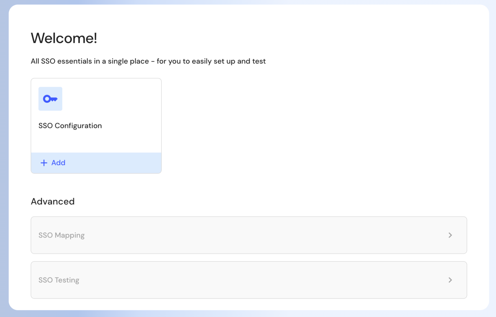
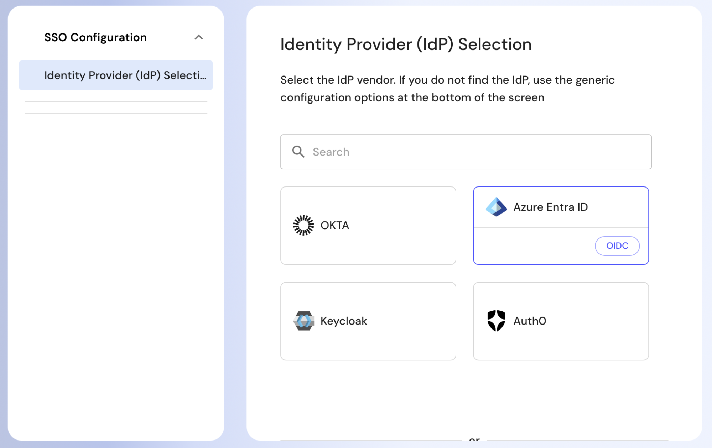
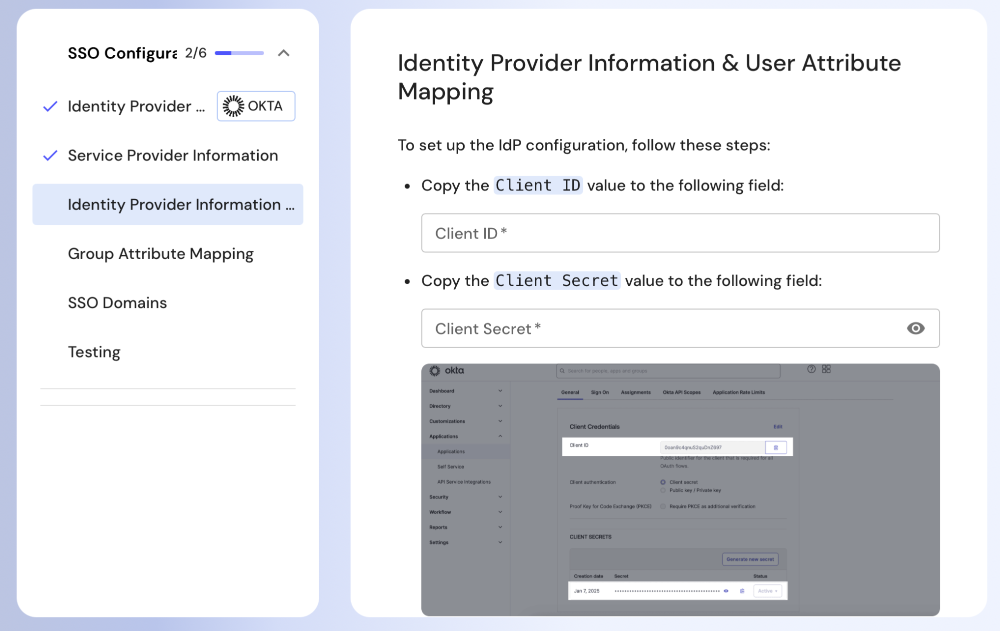

Kosli supports signing in using your identity provider, via single sign-on (SSO). If you don't use an identity provider, [Magic Link](/administration/authentication/magic_link) is an alternative way to sign in.

## Enabling single sign-on

When you are ready for your organization to access Kosli using single sign-on, your IT team will need to configure a new SSO connection. It's done through a self-service setup wizard to make this as straightforward as possible.

Your Kosli Customer Success representative will provide you with a custom direct link to your personalized SSO setup wizard.

## Step by step

Before you begin, you will need access to your Identity Provider (IdP) — such as Azure Entra ID, Okta, or Google Workspace — with permissions to create or modify application registrations and SSO configurations.

<Steps>
  <Step title="Review current status">
    Open the link provided by Kosli. The wizard will display the current state of your SSO connection. If no connection exists yet, you'll see an option to add one.

    <Frame>
      
    </Frame>
  </Step>
  <Step title="Select your identity provider">
    Click **+ Add**, then select your IdP from the list (for example, Okta, Azure Entra ID, Keycloak, or Auth0). Select **OIDC** if there is a choice. The exception is Okta: its SCIM integration only works with a SAML connection, so select **SAML** if you use Okta and expect to add [SCIM provisioning](/administration/managing_users/automated_user_provisioning) — choosing OIDC now means recreating the connection later.

    <Frame>
      
    </Frame>
  </Step>
  <Step title="Configure the connection">
    The wizard will guide you through the setup process with screenshots specific to your IdP. You'll be asked to copy and paste values between your IdP and the wizard.  For an OIDC connection these are the Client ID and Client Secret from your IdP's application registration; for a SAML connection the wizard asks for your IdP's metadata instead.

    <Frame>
      
    </Frame>
  </Step>
  <Step title="Notify Kosli">
    Once you have completed the SSO configuration in the wizard, please let your Kosli Customer Success representative know. We will then switch your email domain to use SSO and confirm when the migration is complete.
  </Step>
</Steps>

## Renew the client secret

An OIDC connection authenticates to your IdP with the Client Secret you entered in the wizard. Most IdPs give client secrets an expiry date, and you should also replace a secret you suspect has been exposed. You update the secret on the existing connection, in the same wizard you used to set it up, without recreating the connection.

Before you start, you need:

- Permission in your IdP to manage the Kosli application registration's client secrets.
- A link to the setup wizard. If you no longer have a working link, ask your Kosli Customer Success representative for one.

<Steps>
  <Step title="Create a new secret in your IdP">
    In the Kosli application registration in your IdP, create a new client secret and copy its value. Leave the old secret in place for now. Most IdPs, such as Azure Entra ID, allow several secrets to be valid at once, so sign-in keeps working while you switch over.
  </Step>
  <Step title="Open your existing connection in the wizard">
    Open the wizard link and select **SSO Configuration**. The wizard shows your current connection.
  </Step>
  <Step title="Replace the Client Secret">
    Go to the step with the **Client ID** and **Client Secret** fields, paste the new value into **Client Secret**, and leave **Client ID** unchanged.
  </Step>
  <Step title="Test and save">
    Click through to the **Testing** page, run the test sign-in, and save the configuration.
  </Step>
  <Step title="Remove the old secret">
    Once a test sign-in with the new secret works, delete the old secret in your IdP.
  </Step>
</Steps>

<Warning>
Renew the secret before the old one expires. If the secret Kosli holds expires or is deleted in your IdP, nobody in your organization can sign in to Kosli with SSO until you enter a valid secret in the wizard. Set a reminder ahead of the expiry date your IdP shows.
</Warning>

SAML connections have no client secret. The equivalent task is renewing your IdP's signing certificate: when it changes, update the IdP metadata in the same way, through **SSO Configuration** in the wizard.

If sign-in fails after the change, check that you copied the secret's value rather than its ID, then contact your Kosli Customer Success representative.

This procedure is separate from [rotating Kosli API keys](/tutorials/rotating_api_keys), which applies to service accounts and personal API keys, not to SSO.
