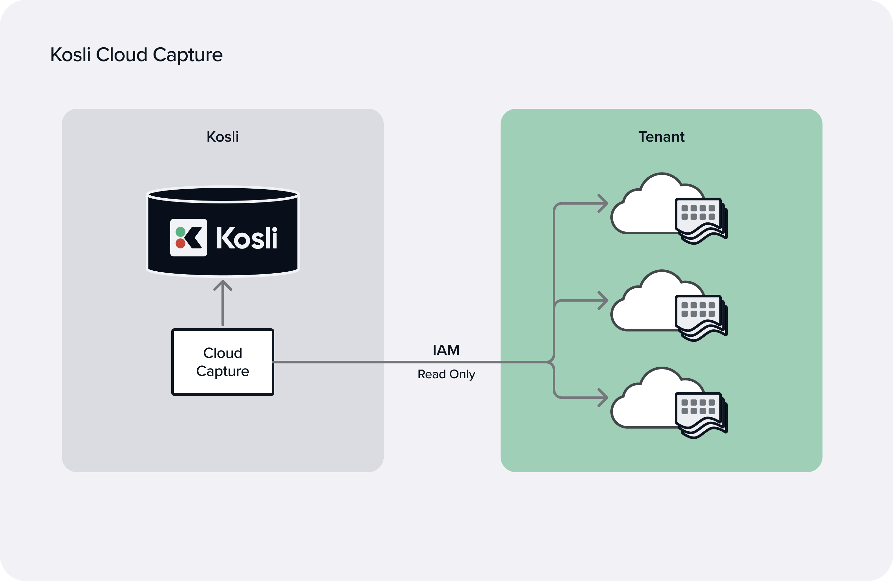

<Warning>
Cloud Capture is still in active development. Its capabilities and configuration format may change, and onboarding is done together with Kosli's Customer Success team.
</Warning>

Cloud Capture is a managed service that runs on Kosli's infrastructure and connects to your cloud platform to observe the resources deployed there. You grant Cloud Capture a set of permissions, and it uses them to run a `kosli snapshot` against the infrastructure you have allowed it to scan, every five minutes unless you [choose another frequency](/administration/cloud_capture/getting_started#scan-frequency).

Kosli also supports reporting from your own cloud accounts by running the Kosli CLI on a schedule. Cloud Capture inverts this, with Kosli running the regular [snapshots](/getting_started/environments) so there is no software for you to install.

To set it up for your organization, see [Getting started with Cloud Capture](/administration/cloud_capture/getting_started).

## Overview

Cloud Capture connects to your cloud accounts using permissions that you manage.  You configure Cloud Capture by activating it for different services, and Cloud Capture uses the permissions to regularly reach into your estate and record snapshots, sending the data into your Kosli organization.  Cloud Capture uses details about your infrastructure, such as the name of an ECS cluster, to build environments within Kosli.

<Frame>

</Frame>

## Supported platforms

| Cloud | Service | Status | What Cloud Capture snapshots |
|---|---|---|---|
| AWS | Amazon ECS | Available | One environment per cluster |
| AWS | AWS Lambda | Available | One environment per region, covering its functions |
| Azure | Azure App Service | Early access | One environment per resource group, covering its running container-based web apps |
| Google Cloud | Cloud Run | Early access | One environment per project and region, covering its services and jobs |
| AWS | Amazon S3 | Planned | |
| Google Cloud | Google Kubernetes Engine (GKE) | Planned | |
| Azure | Azure Kubernetes Service (AKS) | Planned | |

**Early access** platforms are enabled per organization. Contact Kosli's Customer Success team to have one turned on for yours.

**Planned** platforms are on the roadmap but not yet available, and the list may change.

## Security

The security of your cloud infrastructure is the primary driver behind the internal architecture of
Cloud Capture. You grant a read-only identity in your cloud account, protected by a trust condition
that only Kosli can satisfy: an external ID on AWS, which acts as a shared secret between Kosli and
you, and a workload identity pool on Google Cloud. On Kosli's side, each Cloud Capture job runs under a role
scoped to your organization alone, so a worker running for another tenant cannot reach your cloud
account. Cloud Capture holds no tenant data; snapshots go straight to Kosli through the same ingest
path as your existing pipelines. See [Cloud Capture Security](/administration/cloud_capture/security)
for the isolation model and the full list of permissions.

## Hands-off operation

Cloud Capture has been designed to operate with no on-going support from you.  Once the initial security permissions have been created, Cloud Capture will continue to operate in a headless mode. As your cloud infrastructure changes over time, Cloud Capture will continue to find resources without you needing to do anything; your application teams do not need to take any action in order to onboard their products and services into Kosli.

## Finding resources

Cloud Capture finds all [supported resources](#supported-platforms) within your cloud accounts, and determines which Kosli environment should hold the snapshots. Cloud Capture will create physical environments for you inside Kosli. You choose how those environments are named; see [Environment names](/administration/cloud_capture/getting_started#environment-names).

You can keep a resource out of Cloud Capture by tagging it with any tag you have listed in your Cloud Capture settings; see [Excluding resources](/administration/cloud_capture/getting_started#excluding-resources).

As your cloud environment evolves, such as the addition of new AWS ECS clusters or the retirement of existing Lambdas, Cloud Capture automatically detects the changes. Because Cloud Capture creates physical environments as needed, when your infrastructure changes, Kosli will keep up. No changes to the configuration created during the initial setup are required.

## Multiple cloud accounts

Cloud Capture can operate across multiple regions and cloud accounts, such as AWS accounts, Azure subscriptions and Google Cloud projects, allowing you to snapshot development, QA, pre-production, and production workloads with the same process.

## Operation

When Cloud Capture runs against one of your cloud accounts, it starts by gaining temporary credentials for the role you have created. It then uses these credentials to find resources to snapshot, such as all of your AWS ECS clusters or your Google Cloud Run services.  For each resource it identifies, Cloud Capture generates a snapshot within Kosli.
