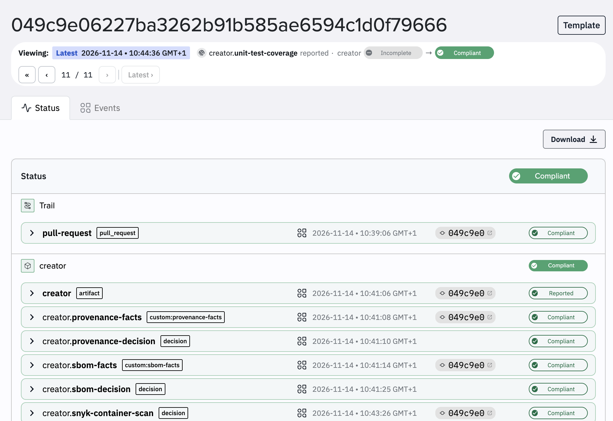
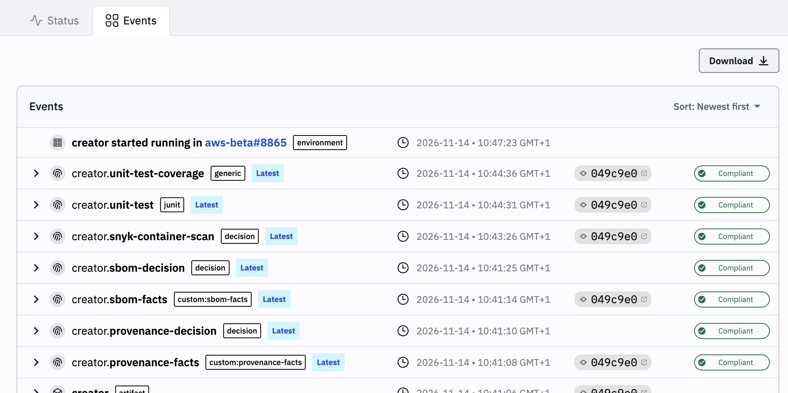
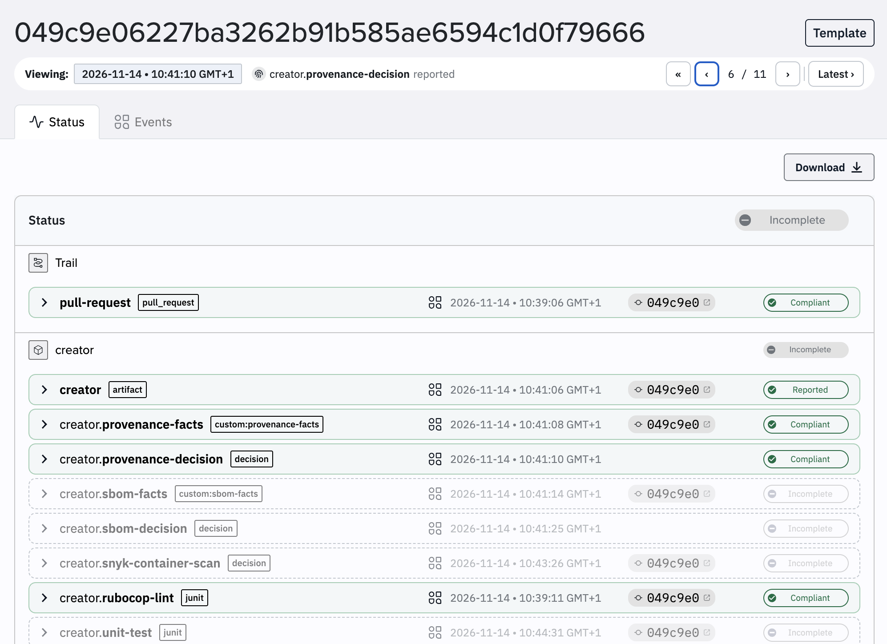
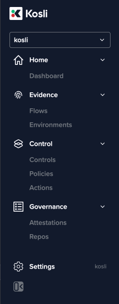

{/*
  Add new entries at the top, newest first. Read docs/writing-product-updates.md first: the Kosli app shows
  these entries, and the tags decide which organizations see each one.
  Tags and the description are for the RSS feed and are hidden on this page with CSS.
  Keep the rss prop so the feed gets one item per entry, and keep id unique and unchanged once published,
  because it is the item's anchor in the feed. Example:

  <Update
    label="November 10, 2026"
    id="short-unique-id"
    tags={["tag"]}
    description="One-sentence summary, hidden on this page."
    rss={{ title: "Short headline for the update", description: "One-sentence summary for the feed.", date: "2026-11-10" }}
  >

  ## Short headline for the update

  One or two sentences on what changed and why it matters to you. Link to the relevant docs page.

  </Update>
*/}

<Update
  label="November 16, 2026"
  id="new-trail-page"
  tags={["new-trail-page"]}
  description="Kosli's trail page now splits into a Status tab and an Events tab, and lets you step back to see a trail at any earlier point in time."
  rss={{
    title: "Getting to know Kosli's new trail page",
    description: "Kosli's trail page now splits into a Status tab and an Events tab, and lets you step back to see a trail at any earlier point in time.",
    date: "2026-11-16"
  }}
>

## Getting to know Kosli's new trail page

Kosli's trail page has a new layout. The old page put the compliance status in a sidebar next to one long timeline of events. On trails with many events, that timeline was slow to load and hard to read, and it was difficult to tell how a trail's compliance had changed over time.

We redesigned the page in response to your feedback. It now puts a trail's status ahead of its events, stays fast on trails with many events, and shows what was true about a trail at the moment a compliance decision was made.

The new page has two tabs: **Status**, which opens first, and **Events**. Everything you saw on the old page is still there, and you can now see how a trail looked at any earlier point in time.

<Frame></Frame>

### The header

The top of the page shows the trail's name, its compliance, and a link to its template. The flow's navigation bar no longer appears on the trail page.

### The Status tab

The Status tab lists the trail's artifacts and the attestations about the trail and each artifact. Each row shows when it's been committed, the associated commit, and its state.

- **Open a row** to see its details in a drawer. The drawer shows details for each attestation type, such as JUnit results, Snyk scans, pull requests and decisions. You can switch the drawer to raw JSON.
- **Artifact compliance** shows next to the artifact's name. Hover over it to see which attestations it comes from.
- **Rows marked +** were reported but are not in the template. **Rows marked -** are in the template but have not been reported yet.
- **Go to the event** with the button on each row, which opens the Events tab at that row's event.

### The Events tab

The Events tab lists every event on the trail, a page at a time. Sort it **Newest first** or **Oldest first**, and open any event to see its attestation.

<Frame></Frame>

### Seeing a trail at an earlier point in time

Every change to a trail is recorded as a trail moment. The **Viewing:** bar above the tabs shows which moment you're looking at, and marks it **Latest** when it's the current one.

- **Step through moments** with the Previous and Next buttons, or jump to the first moment.
- **See what changed:** the bar names the event that created the moment, with the compliance before and after it. Click it to open that event.
- **Start from an event:** click the clock on any row in the Events tab to see the trail at the time of that event.
- **Later reports are grayed out.** On the Status tab, a row that arrived after the moment you're viewing is grayed out, with the time and commit of its later report. On the Events tab, later events are grayed out and the event behind the moment you're viewing is highlighted.
- **Share what you see:** the page's link includes the moment you're viewing, so anyone who opens it sees the same thing.

<Frame></Frame>

### Downloads

The **Download** button below the tabs offers three files:

| Download | What you get |
| :---- | :---- |
| Status PDF | Compliance at the moment you're viewing, stamped with that moment's time |
| Events PDF | Every event on the trail |
| Full audit package | The trail as it is now, with the Status and Events PDFs and all evidence files |

The Status and Events PDFs replace the single combined PDF in every trail audit package, whether you download it from the UI, the API or the CLI. You can also download a single attestation or artifact from its drawer.

We're keen to hear any questions or feedback you might have on the new trail page.

</Update>

<Update
  label="November 10, 2026"
  id="new-navigation"
  tags={["new-navigation"]}
  description="Kosli's sidebar is now grouped into Home, Evidence, Control and Governance, with Settings and the top bar holding the rest."
  rss={{
    title: "Finding your way around Kosli's new navigation",
    description: "Kosli's sidebar is now grouped into Home, Evidence, Control and Governance, with Settings and the top bar holding the rest.",
    date: "2026-11-10"
  }}
>

## Finding your way around Kosli's new navigation

Kosli's left-hand menu has a new layout. The old flat list of a dozen links is now four groups: Home, Evidence, Control and Governance. Every page you used before is still there. Most are now under a group heading, but a few have moved to Settings or to the top bar.

<Frame></Frame>

### Where each page lives now

| Old menu item | Now under |
| :---- | :---- |
| Dashboard | Home |
| Flows | Evidence |
| Environments | Evidence |
| Controls | Control |
| Policies | Control |
| Actions | Control |
| Attestations | Governance |
| Repos | Governance |
| Spaces | Settings, at the bottom of the sidebar |
| Integrations | Settings, at the bottom of the sidebar |
| Settings | Pinned to the bottom of the sidebar |
| Docs | Support menu (**?**) in the top bar |
| API v2 docs | Support menu (**?**) in the top bar, now titled API docs |

The organization switcher still sits at the top of the sidebar. It now has a search box, so you can type a few letters to jump between organizations.

### Settings, Spaces and Integrations

**Settings** is pinned to the bottom of the sidebar, next to the name of the organization you're in. Click it to open that organization's settings. Spaces and Integrations now appear in the settings page's own side menu.

<Frame></Frame>

### The top bar

The top bar holds search and two menus.

- **Support menu (?):** links to Docs, API docs, Support and Feedback, and the Change log.
- **User menu (your avatar):** your name and email, your Profile, and Sign out.

<Frame></Frame>

We're keen to hear any questions or feedback you have on the new menu.

</Update>
