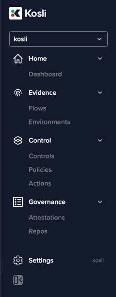
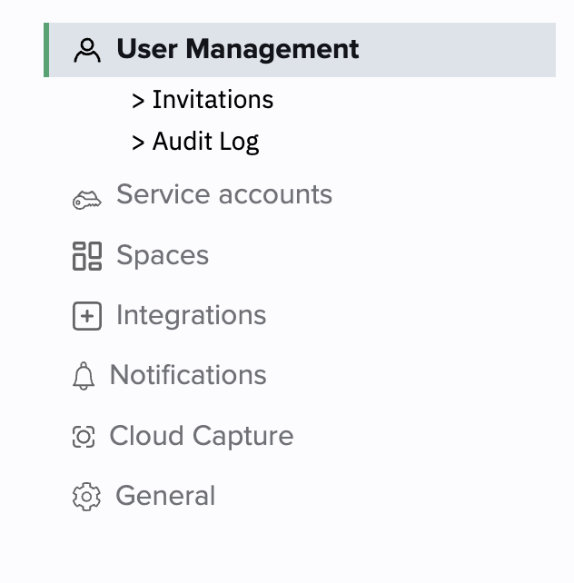
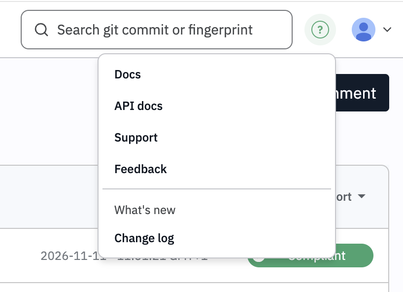

{/*
  Add new entries at the top, newest first. Example:

  <Update label="November 10, 2026" tags={["Platform"]}>

  ## Short headline for the update

  One or two sentences on what changed and why it matters to you. Link to the relevant docs page.

  </Update>
*/}

<Update label="November 10, 2026" tags={["Platform"]}>

## Finding your way around Kosli's new navigation

Kosli's left-hand menu has a new layout. The old flat list of a dozen links is now four groups: Home, Evidence, Control and Governance. Every page you used before is still there. Most are now under a group heading, but a few have moved to Settings or to the top bar.

<Frame></Frame>

### Where each page lives now

| Old menu item | Now under |
| :---- | :---- |
| Dashboard | Home |
| Flows | Evidence |
| Environments | Evidence |
| Controls | Control |
| Policies | Control |
| Actions | Control |
| Attestations | Governance |
| Repos | Governance |
| Spaces | Settings, at the bottom of the sidebar |
| Integrations | Settings, at the bottom of the sidebar |
| Settings | Pinned to the bottom of the sidebar |
| Docs | Support menu (**?**) in the top bar |
| API v2 docs | Support menu (**?**) in the top bar, now titled API docs |

The organization switcher still sits at the top of the sidebar. It now has a search box, so you can type a few letters to jump between organizations.

### Settings, Spaces and Integrations

**Settings** is pinned to the bottom of the sidebar, next to the name of the organization you're in. Click it to open that organization's settings. Spaces and Integrations now appear in the settings page's own side menu.

<Frame></Frame>

### The top bar

The top bar holds search and two menus.

- **Support menu (?):** links to Docs, API docs, Support and Feedback, and the Change log.
- **User menu (your avatar):** your name and email, your Profile, and Sign out.

<Frame></Frame>

We're keen to hear any questions or feedback you have on the new menu.

</Update>
