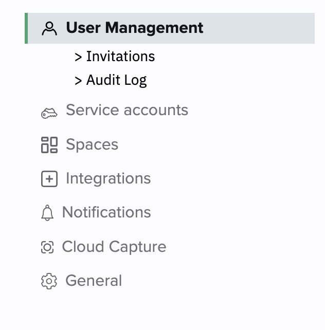
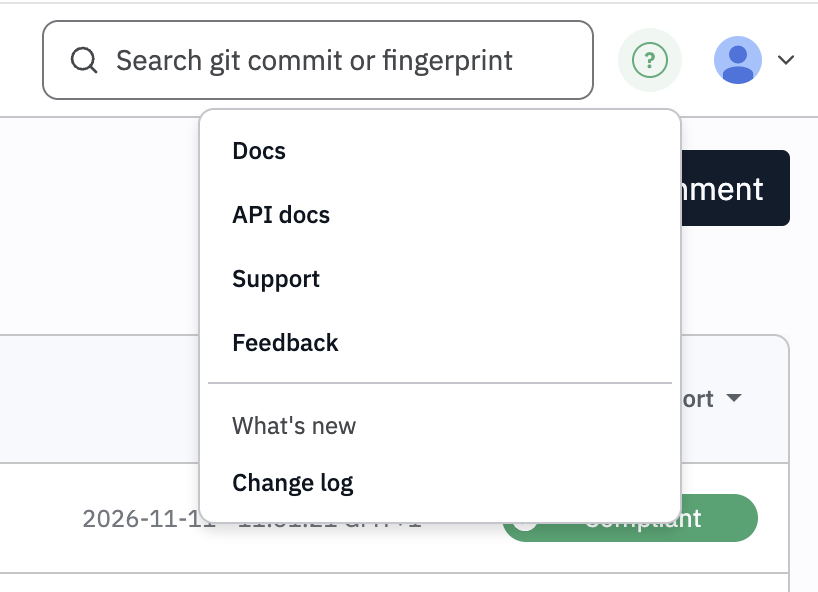

{/*
  Add new entries at the top, newest first. Read docs/writing-product-updates.md first: the Kosli app shows
  these entries, and the tags decide which organizations see each one.
  Tags and the description are for the RSS feed and are hidden on this page with CSS.
  Keep the rss prop so the feed gets one item per entry, and keep id unique and unchanged once published,
  because it is the item's anchor in the feed. Example:

  <Update
    label="November 10, 2026"
    id="short-unique-id"
    tags={["tag"]}
    description="One-sentence summary, hidden on this page."
    rss={{ title: "Short headline for the update", description: "One-sentence summary for the feed.", date: "2026-11-10" }}
  >

  ## Short headline for the update

  One or two sentences on what changed and why it matters to you. Link to the relevant docs page.

  </Update>
*/}

<Update
  label="November 16, 2026"
  id="new-trail-page"
  tags={["new-trail-page"]}
  description="Kosli's trail page now splits into a Status tab and an Events tab, and lets you step back to see a trail at any earlier point in time."
  rss={{
    title: "Getting to know Kosli's new trail page",
    description: "Kosli's trail page now splits into a Status tab and an Events tab, and lets you step back to see a trail at any earlier point in time.",
    date: "2026-11-16"
  }}
>

## Getting to know Kosli's new trail page

Kosli's trail page has a new layout. The old page put the compliance status in a sidebar next to one long timeline of events. On trails with many events, that timeline was slow to load and hard to read, and it was difficult to tell how a trail's compliance had changed over time.

We redesigned the page in response to your feedback. It now puts a trail's status ahead of its events, stays fast on trails with many events, and shows what was true about a trail at the moment a compliance decision was made.

That last point matters most for environment snapshots. When Kosli evaluates a snapshot, it records the state of each trail at that time, called a trail moment. A trail can change after the evaluation, but snapshots could only link to the trail's current status. So a compliant snapshot could link to a trail that now looks non-compliant, or the other way round. Decision attestations and Rego policy evaluations have the same need. Because the trail page can now show any moment, you can see the trail exactly as it was when the decision was made.

The new page has two tabs: **Status**, which opens first, and **Events**. Everything you saw on the old page is still there, and you can now see how a trail looked at any earlier point in time.

<Frame></Frame>

We're keen to hear any questions or feedback you might have on the new trail page.

</Update>

<Update
  label="November 10, 2026"
  id="new-navigation"
  tags={["new-navigation"]}
  description="Kosli's sidebar is now grouped into Home, Evidence, Control and Governance, with Settings and the top bar holding the rest."
  rss={{
    title: "Finding your way around Kosli's new navigation",
    description: "Kosli's sidebar is now grouped into Home, Evidence, Control and Governance, with Settings and the top bar holding the rest.",
    date: "2026-11-10"
  }}
>

## Finding your way around Kosli's new navigation

Kosli's left-hand menu has a new layout. The old flat list of a dozen links is now four groups: Home, Evidence, Control and Governance. Every page you used before is still there. Most are now under a group heading, but a few have moved to Settings or to the top bar.

<Frame></Frame>

### Where each page lives now

| Old menu item | Now under |
| :---- | :---- |
| Dashboard | Home |
| Flows | Evidence |
| Environments | Evidence |
| Controls | Control |
| Policies | Control |
| Actions | Control |
| Attestations | Governance |
| Repos | Governance |
| Spaces | Settings, at the bottom of the sidebar |
| Integrations | Settings, at the bottom of the sidebar |
| Settings | Pinned to the bottom of the sidebar |
| Docs | Support menu (**?**) in the top bar |
| API v2 docs | Support menu (**?**) in the top bar, now titled API docs |

The organization switcher still sits at the top of the sidebar. It now has a search box, so you can type a few letters to jump between organizations.

### Settings, Spaces and Integrations

**Settings** is pinned to the bottom of the sidebar, next to the name of the organization you're in. Click it to open that organization's settings. Spaces and Integrations now appear in the settings page's own side menu.

<Frame></Frame>

### The top bar

The top bar holds search and two menus.

- **Support menu (?):** links to Docs, API docs, Support and Feedback, and the Change log.
- **User menu (your avatar):** your name and email, your Profile, and Sign out.

<Frame></Frame>

We're keen to hear any questions or feedback you have on the new menu.

</Update>
