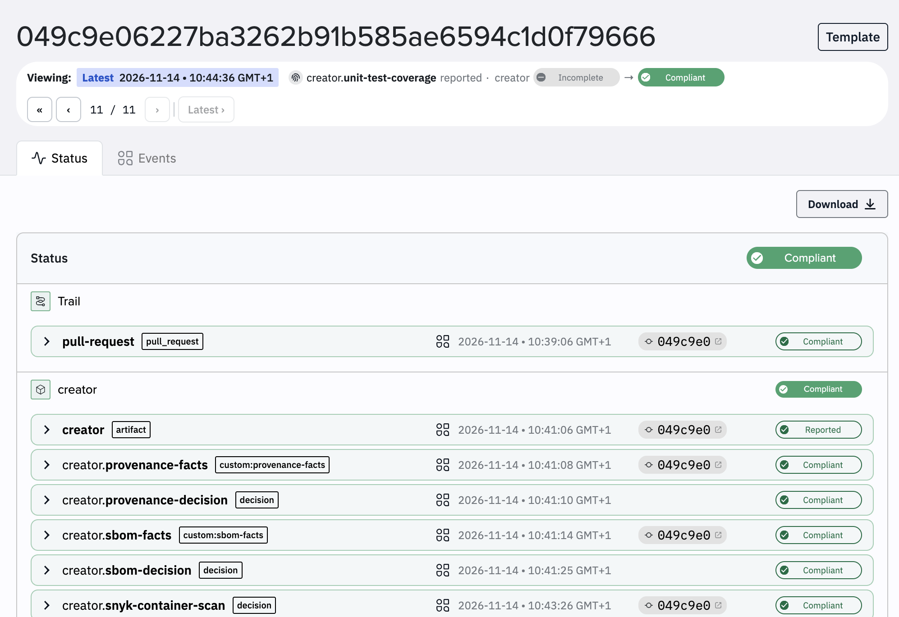

Every time you execute a process represented by a Kosli Flow, you would initiate a `trail` to record the changes made during that specific execution.

You have the flexibility to determine the boundaries of what you consider a single execution of your process. For instance, in a software delivery process, an execution instance might be defined by:

<AccordionGroup>
  <Accordion title="Git commits" icon="code-commit">
    The trail represents changes recorded from a single commit (as reported from CI).
  </Accordion>
  <Accordion title="Pull requests" icon="code-pull-request">
    The trail represents changes recorded throughout the life of a single pull request (can span multiple commits).
  </Accordion>
  <Accordion title="Jira or Github issues" icon="list-check">
    The trail represents changes recorded throughout the life of a single ticket/issue (can span multiple pull requests and commits).
  </Accordion>
</AccordionGroup>

Each trail must possess a unique name within the Flow. This name typically follows a custom pattern, depending on how you define the scope of a single process execution.

## Begin a trail

To begin a Trail, you can run a command similar to the one below:

```shell
kosli begin trail trail-1 --flow process-1 --description "My first trail"
```

Rerunning the command with different description or template file will update the Trail.

See [kosli begin trail](/client_reference/kosli_begin_trail/) for more details.

<Note>
You can overwrite the flow template for each trail using `--template-file`.
By default, the trail inherits the template from its Flow.
</Note>

## View a trail in the Kosli app

Open a trail from its flow in the [Kosli app](https://app.kosli.com) to see its compliance and its history. The trail page shows the trail's name and description, a **Template** button that shows the trail's template, and two tabs: **Status** and **Events**.

<Frame>
  
</Frame>

### Status tab

The **Status** tab opens first. It shows the trail's overall compliance and lists every attestation slot: one **Trail** section for attestations about the trail itself, and one section for each artifact.

- Each row shows the attestation's name, type, when it was reported, its commit and its compliance.
- An artifact's compliance shows on its section header. Hover over it to see which attestations make the artifact non-compliant or incomplete. The artifact's own row only shows that it was reported.
- Rows mark attestations that the template doesn't specify, attestations the template expects that aren't reported yet, and attestations reported with a different type than the template expects.

Select a row to open its details. An attestation shows its details, its attachments and a **Download audit package** button. A decision made by an [Ergo](https://ergo.kosli.com) policy also shows its Ergo report, which explains why the control passed or failed. Turn on the **JSON** switch to see the raw record. An artifact shows its fingerprint, commit, creation time and where it is running.

Each row also has a button that opens the **Events** tab at the event that reported it.

### Events tab

The **Events** tab lists everything that happened to the trail, newest first: the trail starting and being updated, artifacts and attestations being reported, overrides, approvals, deployments and the artifact starting or stopping running in an environment. Sort the list by **Newest first** or **Oldest first**, and page through it 50 events at a time.

Select an event to open its details. Environment events link to the environment snapshot that recorded them instead.

### View a trail at an earlier moment

Kosli records a new [moment](/policy-reference/rego_policy#trail-moment) of the trail each time the trail is started or updated, or an artifact, attestation or override is reported to it. You can view the trail as it was at any of these moments, for example to see what a policy saw when it made a decision.

The **Viewing:** bar above the tabs shows the time you are viewing, and the event that recorded that moment with any change it made to compliance. When you view the newest moment, the bar marks it **Latest**.

- Use the **«**, **‹** and **›** buttons beside the bar to go to the first, previous or next moment. **Latest ›** returns to the newest moment.
- On the **Events** tab, select the clock button on an event to view the trail at that event. Select it again to return to the newest moment.
- Select the event in the **Viewing:** bar to open its row.

Both tabs follow the moment you are viewing. On the **Status** tab, attestations and artifacts reported after that moment are greyed out, and their details show when they arrived, with a button to roll forward to that time. On the **Events** tab, later events are greyed out and the event that recorded the moment is marked.

### Link to a trail at a point in time

The trail page's address includes the moment you are viewing, so you can share a link that opens the trail at that moment. To build a link yourself, add `?at=` to the trail page's URL with a time in UTC, either as Unix epoch seconds or as an ISO 8601 datetime:

```text
https://app.kosli.com/<org>/flows/<flow>/trails/<trail>?at=2026-10-26T06:40:05
```

The page shows the trail as it was at that exact time. The time doesn't have to match an event. Kosli uses these links too: an environment snapshot's trail-compliance result and a control decision open the trail at the moment the policy evaluated it.

### Download a trail's records

Use the **Download** menu below the tabs to download:

- **Status PDF**: the trail's compliance at the moment you are viewing.
- **Events PDF**: all of the trail's events.
- **Full audit package**: the trail's metadata and evidence, at its latest moment.
