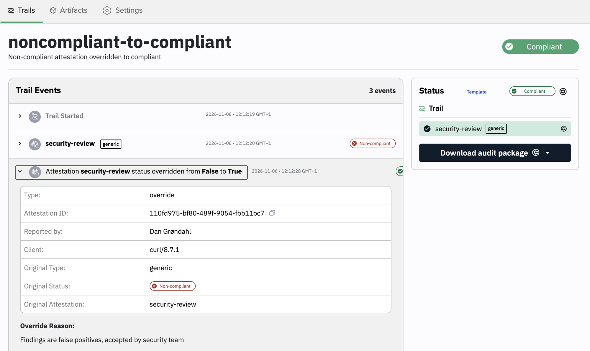
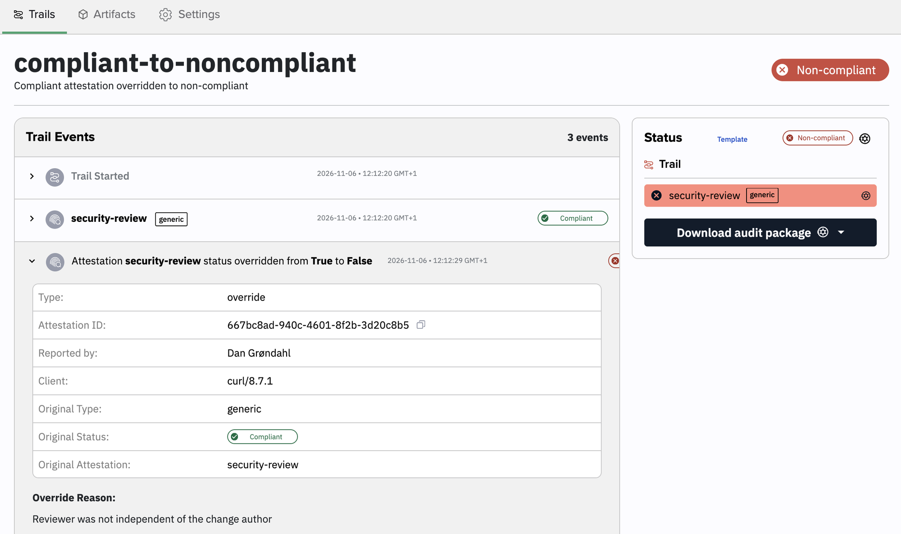

<Warning>
**This endpoint is not part of the public Kosli API yet.** It isn't in the [API reference](/api-reference/overview) or the Swagger docs, and the Kosli CLI has no command for it. Its path, fields, and behavior may change without notice. Only use it if your organization's compliance process allows compliance decisions to be overridden manually.
</Warning>

Sometimes the compliance Kosli calculates for an attestation isn't the decision your organization stands behind. A security scan reports findings that your security team has accepted as false positives, or a review passed but the reviewer turns out not to be independent of the change. An override records that decision on the trail: it sets a new compliance status for one attestation, and stores who made it, when, and why.

An override doesn't delete or edit the original attestation. Both stay in the trail's events, so the audit trail shows the original result and the decision that replaced it.

## Who can override

Overriding is a write to a trail, so it needs the same role as [reporting an attestation](/administration/managing_users/roles_in_kosli): **Admin** or **Member**. Readers and Snapshotters can't override. This applies to users and service accounts alike.

## Send an override

Send a `POST` request to the trail's `override` endpoint. Use the [base URL](/api-reference/overview#base-urls) of the instance your organization lives on:

```
POST /api/v2/attestations/{org}/{flow}/trail/{trail}/override
```

The request body is JSON:

| Field | Required | Description |
|---|---|---|
| `attestation_name` | Yes | Name of the attestation to override, as it appears on the trail or in the [flow template](/getting_started/flows#flow-template). |
| `original_attestation_type` | Yes | Type of the attestation being overridden. Use a built-in type such as `generic`, `junit`, or `snyk`, `custom:<type-name>` for a [custom attestation type](/tutorials/attest_custom), or `system:<type-name>` for a system type. |
| `new_compliance_status` | Yes | `true` to make the attestation compliant, `false` to make it non-compliant. |
| `reason` | Yes | Why the override was made. Shown on the trail and kept in the audit trail. |
| `description` | No | Free-text description of the override. |
| `origin_url` | No | Link to where the override was made, such as a CI run or a ticket. |
| `artifact_fingerprint` | For artifact attestations | Fingerprint of the artifact the attestation is attached to. See [Override an attestation on an artifact](#override-an-attestation-on-an-artifact). |
| `target_artifacts` | For artifact attestations | List holding the template name of the artifact the attestation is attached to, such as `["app"]`. Use it instead of `artifact_fingerprint`, together with `git_commit_info`. |
| `git_commit_info` | With `target_artifacts` | Git commit of the artifact, as an object. Only `sha1` is required; `message`, `author`, `branch`, `timestamp`, and `url` are optional. |
| `repo_info` | No | Repository the git commit belongs to. |
| `user_data` | No | Any JSON object or array to store with the override, kept as sent. Use it for structured context such as a ticket ID or who approved the decision. |
| `annotations` | No | Searchable key-value pairs. Keys may contain only letters, digits, and underscores, and values are strings. |
| `external_urls` | No | Links to external evidence, keyed by a label of your choosing. Each entry is an object with an `href` and an optional `fingerprint`. |

The endpoint returns `200` with the body `"OK"`. The trail's compliance is then recalculated with the new status.

The optional fields are stored on the override, not on the original attestation. For example, this override links the decision to a risk-acceptance ticket:

```shell
curl -X POST \
  "https://app.kosli.com/api/v2/attestations/$KOSLI_ORG/my-flow/trail/my-trail/override" \
  -H "Authorization: Bearer $KOSLI_API_TOKEN" \
  -H "Content-Type: application/json" \
  -d '{
    "attestation_name": "security-review",
    "original_attestation_type": "generic",
    "new_compliance_status": true,
    "reason": "Risk accepted by security team",
    "user_data": {"ticket": "SEC-123", "approved_by": "security-team"},
    "annotations": {"risk_acceptance": "SEC-123"},
    "external_urls": {"ticket": {"href": "https://example.com/browse/SEC-123"}}
  }'
```

### Make a non-compliant attestation compliant

A trail is non-compliant because its `security-review` attestation reported findings. The security team has reviewed them and accepts them as false positives:

```shell
curl -X POST \
  "https://app.kosli.com/api/v2/attestations/$KOSLI_ORG/my-flow/trail/my-trail/override" \
  -H "Authorization: Bearer $KOSLI_API_TOKEN" \
  -H "Content-Type: application/json" \
  -d '{
    "attestation_name": "security-review",
    "original_attestation_type": "generic",
    "new_compliance_status": true,
    "reason": "Findings are false positives, accepted by security team"
  }'
```

The trail becomes compliant. Its events show the original non-compliant attestation and, after it, the override with its reason:

<Frame>
  
</Frame>

### Make a compliant attestation non-compliant

An override works in the other direction too. The `security-review` attestation passed, but the reviewer was not independent of the change author:

```shell
curl -X POST \
  "https://app.kosli.com/api/v2/attestations/$KOSLI_ORG/my-flow/trail/my-trail/override" \
  -H "Authorization: Bearer $KOSLI_API_TOKEN" \
  -H "Content-Type: application/json" \
  -d '{
    "attestation_name": "security-review",
    "original_attestation_type": "generic",
    "new_compliance_status": false,
    "reason": "Reviewer was not independent of the change author"
  }'
```

The trail becomes non-compliant:

<Frame>
  
</Frame>

### Override an attestation on an artifact

When the flow template puts the attestation under an artifact, tell Kosli which artifact it belongs to. Use the attestation's own name, such as `unit-tests`, not the qualified `app.unit-tests`. There are two ways to point at the artifact.

By fingerprint:

```shell
curl -X POST \
  "https://app.kosli.com/api/v2/attestations/$KOSLI_ORG/my-flow/trail/my-trail/override" \
  -H "Authorization: Bearer $KOSLI_API_TOKEN" \
  -H "Content-Type: application/json" \
  -d '{
    "attestation_name": "unit-tests",
    "original_attestation_type": "generic",
    "artifact_fingerprint": "62ad1a496f7a6f219be23d83c09696c950fad7f9c59c61a24d9a28c7575c43fb",
    "new_compliance_status": true,
    "reason": "Flaky test, fixed in the next release"
  }'
```

By the artifact's template name and git commit:

```shell
curl -X POST \
  "https://app.kosli.com/api/v2/attestations/$KOSLI_ORG/my-flow/trail/my-trail/override" \
  -H "Authorization: Bearer $KOSLI_API_TOKEN" \
  -H "Content-Type: application/json" \
  -d '{
    "attestation_name": "unit-tests",
    "original_attestation_type": "generic",
    "target_artifacts": ["app"],
    "git_commit_info": {"sha1": "a65f3a61100781a827247a22ca3b22f290d15bc1"},
    "new_compliance_status": true,
    "reason": "Flaky test, fixed in the next release"
  }'
```

Either way, the artifact and the trail are re-evaluated with the new status.

<Warning>
If you leave out both `artifact_fingerprint` and `target_artifacts`, the override doesn't attach to the artifact's attestation. Kosli records it as a new, unexpected attestation on the trail instead. The artifact keeps its old status, and an override with `new_compliance_status: false` makes the whole trail non-compliant.
</Warning>

## How overrides behave

- **An override applies to the latest attestation with that name.** If a new attestation with the same name is reported after the override, the new attestation's own status applies again. Override again if the decision still holds.
- **You can override an attestation that hasn't been reported.** If the flow template expects an attestation that is missing, an override with `new_compliance_status: true` marks it compliant and the trail is no longer incomplete.
- **You can't override an attestation that doesn't exist anywhere.** If the attestation is neither on the trail nor in its template, the request fails with a `400` error.
- **The artifact must be reported first.** Overriding an attestation on an artifact that isn't on the trail yet fails: with `404` when you use `artifact_fingerprint`, and with `400` when you use `target_artifacts`.
- **You can't override on an archived flow.**

## Find overrides in the audit trail

Each override is recorded as an `attestation_overridden` event on the trail. In the web app it appears in the trail's events as "Attestation _name_ status overridden from _old_ to _new_", with the reason, the original attestation, its original status, and who made the override.

Through the API, read it from the trail's events:

```shell
curl -H "Authorization: Bearer $KOSLI_API_TOKEN" \
  "https://app.kosli.com/api/v2/trails/$KOSLI_ORG/my-flow/my-trail/events"
```

```json
{
  "type": "attestation_overridden",
  "attestation_name": "security-review",
  "reason": "Reviewer was not independent of the change author",
  "new_compliance_status": false,
  "original_attestation_id": "6c742f1f-0502-4d8d-b46d-99960f6d",
  "original_attestation_type": "generic",
  "original_attestation_status": true,
  "override_attestation_id": "667bc8ad-940c-4601-8f2b-3d20c8b5"
}
```

In the trail's compliance status, an overridden attestation carries an `overridden_attestation_id` next to its `attestation_id`, and its `is_compliant` shows the overridden value.

## Run overrides from a manually triggered workflow

To keep overrides out of ad-hoc terminal sessions, run them from a CI workflow that someone triggers by hand. The person who triggers it, the inputs they gave, and the run itself are then recorded in your CI system as well as in Kosli, and you control who can run it with your CI system's permissions.

This GitHub Actions workflow runs on `workflow_dispatch` and takes the override fields as inputs:

```yaml .github/workflows/kosli-override.yml
name: Override attestation compliance

on:
  workflow_dispatch:
    inputs:
      flow:
        description: Flow name
        required: true
      trail:
        description: Trail name
        required: true
      attestation_name:
        description: Name of the attestation to override
        required: true
      attestation_type:
        description: Type of the attestation, such as generic or custom:<type-name>
        required: true
        default: generic
      compliant:
        description: New compliance status
        required: true
        type: boolean
      reason:
        description: Why the override is made
        required: true

jobs:
  override:
    runs-on: ubuntu-latest
    environment: kosli-overrides
    steps:
      - name: Override attestation compliance
        env:
          KOSLI_API_TOKEN: ${{ secrets.KOSLI_API_TOKEN }}
          KOSLI_ORG: ${{ vars.KOSLI_ORG }}
          KOSLI_HOST: ${{ vars.KOSLI_HOST }}
          FLOW: ${{ inputs.flow }}
          TRAIL: ${{ inputs.trail }}
          ATTESTATION_NAME: ${{ inputs.attestation_name }}
          ATTESTATION_TYPE: ${{ inputs.attestation_type }}
          COMPLIANT: ${{ inputs.compliant }}
          REASON: ${{ inputs.reason }}
          ORIGIN_URL: ${{ github.server_url }}/${{ github.repository }}/actions/runs/${{ github.run_id }}
        run: |
          body=$(jq -n \
            --arg name "$ATTESTATION_NAME" \
            --arg type "$ATTESTATION_TYPE" \
            --argjson compliant "$COMPLIANT" \
            --arg reason "$REASON (triggered by $GITHUB_ACTOR)" \
            --arg origin_url "$ORIGIN_URL" \
            '{attestation_name: $name, original_attestation_type: $type,
              new_compliance_status: $compliant, reason: $reason, origin_url: $origin_url}')

          curl --fail-with-body -X POST \
            "${KOSLI_HOST:-https://app.kosli.com}/api/v2/attestations/$KOSLI_ORG/$FLOW/trail/$TRAIL/override" \
            -H "Authorization: Bearer $KOSLI_API_TOKEN" \
            -H "Content-Type: application/json" \
            -d "$body"
```

A few things make this workflow safer to run:

- **Inputs go through environment variables and `jq`**, not straight into the script, so a value with quotes or shell characters can't break the request or inject commands.
- **The host comes from the `KOSLI_HOST` repository variable** and falls back to `https://app.kosli.com`. Set it to `https://app.us.kosli.com` or your Kosli Dedicated address if your organization lives on another [instance](/api-reference/overview#base-urls).
- **`origin_url` links the override back to the workflow run**, so anyone reading the trail can see where it came from.
- **The `kosli-overrides` [GitHub environment](https://docs.github.com/en/actions/managing-workflow-runs-and-deployments/managing-deployments/managing-environments-for-deployment)** can require approval from named reviewers before the job runs. Store the API key of a dedicated [service account](/administration/authentication/service_accounts) with the Member role as a secret of that environment, so only approved runs can use it.

<Note>
Kosli records the service account as the reporter of the override, not the person who triggered the workflow. That's why the workflow adds `$GITHUB_ACTOR` to the reason.
</Note>
