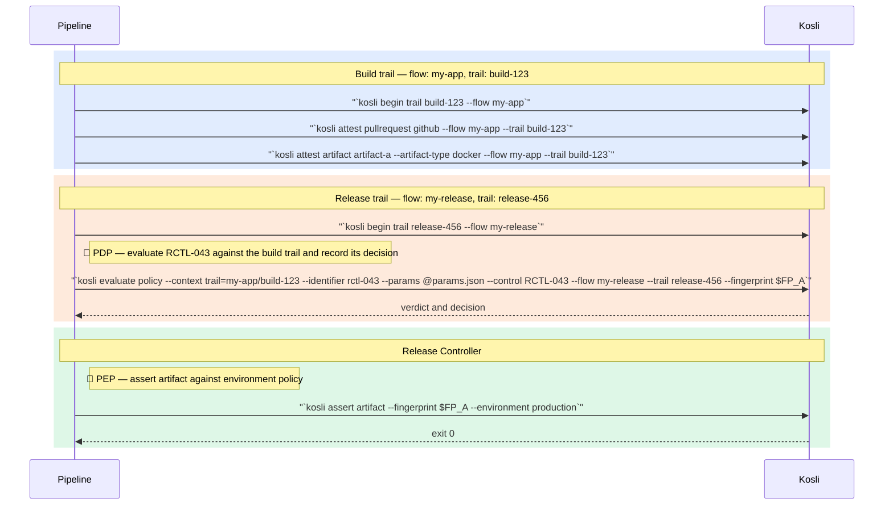

<Info>
**This feature is in beta.** Controls, decisions, the controls CLI commands (`kosli create control` and related), server-side evaluation (`kosli publish rego-policy` and `kosli evaluate policy`), and the `for_control` policy requirement are all available in Kosli but in beta — the UI, CLI flags, and policy YAML schema may still change. It is rolled out per organization, so reach out to the Kosli team to enable it for yours, or with any questions and comments.
</Info>

Controls in Kosli represent the named, identifiable governance requirements that your organization enforces across software delivery — things like "source code review", "no hard-coded credentials", or "vulnerability scan passed". They are the things auditors ask about, the things compliance teams track, and the things governance platform engineers build automation around.

Without controls as first-class entities, Kosli can tell you _that_ an attestation was made, but not _which governance requirement it satisfies_. Controls close that gap: they connect the evidence you collect in pipelines to the specific requirements that auditors, control owners, and regulators care about.

This tutorial covers how to:

- Define a control library in Kosli that mirrors your existing controls catalog
- Write, test, and publish a policy that decides a control
- Record decisions against controls by evaluating published policies from your pipelines
- Require controls in environment policies and gate deployments on them
- Review the decisions and version history of each control
- Manage your catalog: list and archive controls

## Prerequisites

- [Install Kosli CLI](/getting_started/install).
- [Get a Kosli API token](/administration/authentication/service_accounts).
- Have at least one [Flow](/getting_started/flows) and [Trail](/getting_started/trails) already created.

## Setup

```bash
export KOSLI_ORG=<your-org>
export KOSLI_API_TOKEN=<your-api-token>
```

## Understanding controls

Before creating controls, it helps to understand how they fit into the Kosli data model.

**Controls** are the named governance requirements your organization enforces. They have a stable identity (the control identifier), a human-readable name, and an optional description and links pointing back to your GRC system or policy document.

<Info>
  Kosli holds a mirror to your existing control definitions — it does not replace your GRC system or ServiceNow instance. The control catalog in Kosli is a lightweight copy that enables querying and reporting.
</Info>

**Raw fact attestations** are the evidence you collect in pipelines — test results, vulnerability scans, pull request approvals. These are facts about what happened.

**Policies** are the rules that judge whether the evidence satisfies a control. A policy is written as YAML requirements with [Ergo](https://ergo.kosli.com), or in plain Rego, published to Kosli by an org admin, and evaluated by Kosli against the trails you name.

**Decisions** are the recorded outcomes of a Policy Decision Point (PDP) — the step in your process where a judgment is reached about a specific control: "control `RCTL-043` is satisfied for this artifact." In Kosli, the PDP is a server-side evaluation: Kosli evaluates a published policy and records the outcome as a decision against the control. A decision is recorded at the point where the judgment is made — typically during a release or promotion step.

A decision must be **complete**: one decision closes a control, and there is no partial decision. When a control depends on several checks — for example unit, integration, and system tests — the policy that records the control's decision has to cover all of them.

<Note>
  Multi-level evaluations are not supported yet: a policy cannot read the outcome of other evaluations or decisions, so several evaluations cannot be combined into one control's decision. Until then, write one policy per control that checks everything the control requires.
</Note>

This separation matters: raw facts exist independently of controls. A JUnit test report is a fact. Whether that test report satisfies a "test coverage" control is a decision. The decision references the fact; the fact doesn't need to know about the control.

**Environment policies** state what an artifact must satisfy to run in an environment, and can require a passing decision for named controls. A Policy Enforcement Point (PEP) is where that requirement is acted upon: `kosli assert artifact --environment` checks an artifact against the environment's policy and exits non-zero if it doesn't comply. Place it at the point in your pipeline where you want to gate progress on control compliance.

## Creating a control

A control has the following fields:

| Field | Description |
|-------|-------------|
| **Identifier** | **Required.** The control identifier (e.g. `RCTL-043`, `peer-review`, `vuln-scan-production`). Unique within your organization and **immutable once created** — to use a different identifier, create a new control. |
| **Name** | **Required.** A human-readable label for the control (e.g. `Source code review`). You can rename a control while keeping the same identifier. |
| **Description** | Optional. What the control does, in human-readable terms. |
| **Links** | Optional. One or more named URLs pointing back to the authoritative definition in your GRC system, ServiceNow, or policy document. |

Only org admins can create or edit controls. Create one in the Kosli app, with the CLI, or through the API.

<Tabs>
  <Tab title="Kosli app">
    Navigate to **Controls** in the [Kosli app](https://app.kosli.com) sidebar, select **New control**, and fill in the fields.
  </Tab>
  <Tab title="CLI">
    Create a control with `kosli create control`. `--name` is required; `--description` and `--link` are optional.

    ```bash
    kosli create control RCTL-043 \
        --name "Source code review" \
        --description "All changes are reviewed by a second developer before release."
    ```
  </Tab>
  <Tab title="API">
    Create a control with a `POST` to `/api/v2/controls/{org}`. `identifier` and `name` are required; `description` and `links` are optional.

    ```bash
    curl -X POST "https://app.kosli.com/api/v2/controls/$KOSLI_ORG" \
        -H "Authorization: Bearer $KOSLI_API_TOKEN" \
        -H "Content-Type: application/json" \
        -d '{
              "identifier": "RCTL-043",
              "name": "Source code review",
              "description": "All changes are reviewed by a second developer before release."
            }'
    ```
  </Tab>
</Tabs>

Each change to a control's name, description, or links creates a new version. Make one with `kosli update control`, or from the control's detail page in the app:

```bash
kosli update control RCTL-043 \
    --description "All commits are reviewed by a second developer before release."
```

Decisions always reference the version of the control that was current when they were recorded, so the audit trail stays precise as controls evolve.

**Tags** are added separately — from a control's detail page, or with `kosli tag control CONTROL-IDENTIFIER --set key=value`. Tagging doesn't create a new version.

<Tip>
  Control identifiers are the stable identity that decisions and environment policies reference. Choose identifiers that match how your organization already refers to controls — for example, the identifiers in your ServiceNow or GRC system. If you use `RCTL-043` today, use exactly that.
</Tip>

## Writing a policy for the control

A decision comes from a policy: Kosli evaluates a policy, written with [Ergo](https://ergo.kosli.com) or in plain [Rego](/policy-reference/rego_policy), against your trails and records the outcome against the control. Write the policy, test it against a real trail, then publish it.

The example below decides `RCTL-043` with the simplest possible check: the trail has a compliant pull request attestation. The attestation name is read from params — values passed to each evaluation with `--params` — so the same policy works whatever your pipelines call the attestation.

<Tabs>
  <Tab title="Ergo">
    [Ergo](https://ergo.kosli.com) is an open source Rego library, maintained by Kosli, that lets you write a policy's requirements as YAML sentences instead of Rego rules. Its report records every check it ran, passed or failed, which makes a denial easy to read.

    Download `ergo.rego` from a pinned release, so a new Ergo version can't change your policy unexpectedly, and create a directory for the policy:

    ```bash
    curl -L --create-dirs -o lib/ergo.rego \
        https://github.com/kosli-dev/ergo/releases/download/rego-v0.2.0/ergo.rego
    mkdir rctl-043
    ```

    Write the requirements in `rctl-043/policy.ergo.yaml`. Kosli loads `*.ergo.yaml` files into `data`, so the policy can read them:

    ```yaml rctl-043/policy.ergo.yaml
    ergo_spec: v0.2
    description: The trail has a compliant pull request attestation
    subjects:
      pull request attestation:
        description: The attestation named by the pr_attestation_name param
        from: trail.compliance_status.attestations_statuses named by $params.pr_attestation_name
    requirements:
      code_review:
        description: The change was reviewed in a pull request
        subject: pull request attestation
        checks:
          recorded:
            description: The pull request attestation is recorded on the trail
            assert: status is "COMPLETE"
          compliant:
            description: The pull request attestation is compliant
            assert: is_compliant is true
    ```

    Then hand the requirements to Ergo in `rctl-043/policy.rego`. `allow` is Ergo's overall answer, and `violations` lists the checks that failed:

    ```rego rctl-043/policy.rego
    package policy

    import data.ergo
    import rego.v1

    default ergo_spec := null

    ergo_spec := data.ergo_spec

    default subjects := {}

    subjects := data.subjects

    default requirements := {}

    requirements := data.requirements

    # METADATA
    # entrypoint: true
    report := ergo.report(input, {"ergo_spec": ergo_spec, "subjects": subjects, "requirements": requirements}, data.params)

    default allow := false

    allow if report.compliant

    # METADATA
    # entrypoint: true
    violations := ergo.violations(report)
    ```

    Pass both the policy directory and the library wherever a command takes `--path`:

    ```bash
    POLICY_PATHS=(--path rctl-043/ --path lib/ergo.rego)
    ```

    See the [Ergo documentation](https://ergo.kosli.com) for subjects, sentences, and the report format.
  </Tab>
  <Tab title="Rego">
    Write the policy in plain Rego in `rctl-043/policy.rego`. It follows the [policy contract](/policy-reference/rego_policy#policy-contract): a boolean `allow` with a safe default, and `violations` to explain a denial.

    ```rego rctl-043/policy.rego
    package policy

    import rego.v1

    pr_attestation_name := data.params.pr_attestation_name

    default allow := false

    allow if {
        pr := input.trail.compliance_status.attestations_statuses[pr_attestation_name]
        pr.status == "COMPLETE"
        pr.is_compliant == true
    }

    # METADATA
    # entrypoint: true
    violations contains msg if {
        not input.trail.compliance_status.attestations_statuses[pr_attestation_name]
        msg := sprintf("trail has no attestation named '%v'", [pr_attestation_name])
    }

    violations contains msg if {
        pr := input.trail.compliance_status.attestations_statuses[pr_attestation_name]
        pr.is_compliant != true
        msg := sprintf("attestation '%v' is not compliant", [pr_attestation_name])
    }
    ```

    Pass the policy directory wherever a command takes `--path`:

    ```bash
    POLICY_PATHS=(--path rctl-043/)
    ```
  </Tab>
</Tabs>

### Test the policy

Before publishing, evaluate the local files against a trail that already has the attestation. `--path` sends the files with the evaluation, Kosli runs them exactly as it will run the published policy, and nothing is recorded:

```bash
kosli evaluate policy \
    --context trail=my-release-flow/my-release-trail \
    "${POLICY_PATHS[@]}" \
    --params '{"pr_attestation_name": "pull-request"}'
```

The command prints `RESULT: ALLOWED` or `RESULT: DENIED`, with the violations. Try it against a trail without the attestation to see the denial. See [Seeing the input](/policy-reference/rego_policy#seeing-the-input) to inspect the data the policy receives.

### Publish the policy

Publish the policy under an identifier. Each publish stores a new version, and evaluations run the newest valid one. `--input-schema trail` gives the policy a single [trail moment](/policy-reference/rego_policy#trail-moment) as `input.trail`:

```bash
kosli publish rego-policy rctl-043 \
    "${POLICY_PATHS[@]}" \
    --input-schema trail \
    --name "Source code review"
```

Only org admins can publish, and only a published policy can record a decision. This keeps the judgment out of the hands of the team being judged: Kosli runs the evaluation and records the decision itself, so a pipeline cannot swap in its own policy or alter the result on its way into Kosli.

A policy and its control are versioned separately. The control states the requirement and changes rarely; the policy implements the check and changes whenever you refine it, for example to read a new attestation. Publishing a new policy version doesn't change the control, and editing the control doesn't change the policy. Each decision cites both versions.

## Recording a decision against a control

Evaluate the published policy and name the control it decides. Use `--fingerprint` to identify the artifact the decision applies to — this is what allows [`kosli assert artifact --environment`](#asserting-artifact-compliance) to later check that all required controls have passing decisions for that artifact specifically.

```bash
kosli evaluate policy \
    --context trail=my-release-flow/my-release-trail \
    --identifier rctl-043 \
    --params '{"pr_attestation_name": "pull-request"}' \
    --control RCTL-043 \
    --flow my-release-flow \
    --trail my-release-trail \
    --fingerprint "$ARTIFACT_FINGERPRINT" \
    --name source-code-review-decision
```

| Flag | Description |
|------|-------------|
| `--context` | **Required.** A trail to evaluate, as `trail=<flow>/<trail>`. Repeat it to evaluate several trails together; see [Evaluating several trails](#evaluating-several-trails). |
| `--identifier` | **Required to record a decision.** The published policy to evaluate. Its current version runs, and the decision cites that version. |
| `--control` | The control identifier the decision is recorded against. Without it, the evaluation records nothing. |
| `--flow`, `--trail` | The flow and trail the decision is recorded in. Required with `--control`; can be set as `KOSLI_FLOW` and `KOSLI_TRAIL`. |
| `--fingerprint` | The SHA256 fingerprint of the artifact the decision applies to. Omit it to record the decision against the trail itself. |
| `--name` | The attestation name the decision is recorded under. Defaults to `<control>-decision`. |
| `--params` | Values the policy reads as `data.params`, as inline JSON or `@file.json`. They must match the params schema of the policy's current version. |

Kosli evaluates the policy where the trails are stored and records the decision in the same request, so the outcome never passes through your pipeline. The decision carries its evidence: the policy version that ran, the params, the result, and the policy files as an attachment. You can record more than one decision for the same control; the most recent one is used when evaluating compliance.

### Evaluating several trails

A control often depends on evidence spread across trails, such as a build trail with the pull request and a release trail with the approval. Name each trail with its own `--context`. Kosli reads them all at the same instant and passes them to the policy as the `input.trails` array:

```bash
kosli evaluate policy \
    --context trail=my-app/build-123 \
    --context trail=my-release/release-456 \
    --identifier rctl-043-multi \
    --control RCTL-043 \
    --flow my-release \
    --trail release-456 \
    --fingerprint "$ARTIFACT_FINGERPRINT"
```

A policy that reads several trails must be published with `--input-schema trails`, and reads `input.trails` instead of `input.trail`. The order of the array carries no meaning, so select a trail by its `flow_name` and `trail_name`. The decision is still recorded in the one trail named by `--flow` and `--trail`. See [Input data](/policy-reference/rego_policy#input-data) and the [multi-trail example](/policy-reference/rego_policy#require-a-compliant-pull-request-on-every-trail).

## Requiring controls in environment policies

Environment policies define the requirements an artifact must satisfy before it can run in a given environment. You can require that specific named controls have a passing decision recorded, making individual controls explicit policy gates.

```yaml prod-policy.yaml
_schema: https://docs.kosli.com/schemas/policy/v1
artifacts:
  provenance:
    required: true
  attestations:
    - type: decision
      for_control: RCTL-043
    - type: decision
      for_control: RCTL-1866
```

Each `attestations` rule with `type: decision` and a `for_control` identifier requires a compliant decision recorded for that control. The control must already exist in your organization — unlike recording a decision, a policy that references an unknown control identifier is rejected. With this policy in place, an artifact deployed to this environment will be marked **non-compliant** if a passing decision has not been recorded for that artifact for each listed control. The artifact can still be deployed — Kosli records compliance state but does not block deployments by default. To gate deployments on compliance, use [`kosli assert`](/getting_started/enforce_policies) in your pipeline. This abstracts the policy from the specific tooling your pipelines use: instead of "has an attestation of type `snyk` with zero criticals", the policy expresses "control `RCTL-1866` has been satisfied" — and the decision attestation carries the evidence of how that judgment was reached.

For the complete policy syntax, including attestation requirements and exceptions, see the [Environment Policies](/getting_started/policies) page.

## Asserting artifact compliance

`kosli assert artifact --environment` is the Policy Enforcement Point (PEP). It checks that an artifact satisfies all requirements in the environment's attached policy — including any controls required via `for_control` rules — and exits non-zero if it doesn't. Use it as a pipeline gate before promoting an artifact to an environment.

```bash
kosli assert artifact \
    --fingerprint "$ARTIFACT_FINGERPRINT" \
    --environment production
```

| Flag | Description |
|------|-------------|
| `--fingerprint` | The SHA256 fingerprint of the artifact to assert. |
| `--artifact-type` | The artifact type (e.g. `docker`, `file`). Provide this with the artifact name/path as the command argument instead of `--fingerprint` to have Kosli calculate the fingerprint. |
| `--environment` | **Required.** The Kosli environment whose attached policy the artifact is asserted against. |

If the artifact satisfies all policy requirements — including passing decisions for every listed control — the command exits 0. If not, the command exits non-zero and prints which requirements were not met, failing the pipeline step.

<Tip>
  `kosli evaluate policy --control` is the PDP: it records a judgment about a control. `kosli assert artifact --environment` is the PEP: it enforces that judgment as part of the environment policy. Keep them in separate pipeline steps — the PDP step is where evidence is evaluated and the outcome is recorded; the PEP step is where the pipeline gates on that recorded outcome.
</Tip>

## End-to-end pipeline flow

The sequence below shows a single artifact moving through a build trail and a release trail, with the compliance decision made at release time and enforced by the release controller checking the environment policy.



## Viewing a control

Navigate to **Controls** in the [Kosli app](https://app.kosli.com) and select a control to see its detail view. The header shows the identifier, current version, name, any links, description, and tags. Below it are two tabs: **Decisions** and **Versions**.

### Decisions

The Decisions tab is the default view. It lists every decision recorded against this control across all flows and trails, with the timestamp, the trail it was recorded on, the artifact fingerprint, and the outcome (compliant or non-compliant). Filter by outcome and flow, and sort by timestamp, to narrow the list.

<Frame>
  
</Frame>

Select a decision to open its detail, showing the trail it is recorded on, the trails it was evaluated against and when, the policy and version that judged it, the artifact it applies to, and the evaluated policy bundle (`policy.tar.gz`) attached as evidence.

<Frame>
  
</Frame>

### Versions

The Versions tab lists every version of the control definition — the name, description, and links as they were at each version, with who made the change and when. Because every decision references the control version that was current when it was recorded, this history lets auditors see exactly what the control required at the time of each decision. Changes to the policy that decides the control don't appear here: policy versions are tracked separately, and each decision names the policy version that judged it.

## Managing your controls catalog

As your catalog grows, list and search it, and archive controls you retire.

### Listing controls

Navigate to **Controls** in the [Kosli app](https://app.kosli.com) sidebar to browse your full controls catalog. Search by name or identifier, and filter by tag to narrow the list. Each control shows its identifier, description, tags, name, and current version.

<Frame>
  
</Frame>

You can also list controls from the CLI with `kosli list controls`, fetch a single control with `kosli get control CONTROL-IDENTIFIER`, or use the controls API (`GET /api/v2/controls/{org}`).

### Archiving a control

When a control is retired, archive it rather than deleting it. Archiving moves the control out of the main catalog into its **Archived** view but preserves its full history — past decisions and every version of the definition remain intact for audit — and an archived control can be unarchived later if it comes back into use.

Archive or unarchive a control from its detail page (org admins only), from the CLI with `kosli archive control CONTROL-IDENTIFIER` and `kosli unarchive control CONTROL-IDENTIFIER`, or through the controls API (`POST /api/v2/controls/{org}/{identifier}/archive` and `.../unarchive`). Both actions appear as events in the control's **Versions** tab, alongside Created and Edited events, so the full lifecycle is auditable.

## What you've accomplished

You have learned how to define controls in Kosli, write, test, and publish a policy that decides a control, record decisions by evaluating that policy with `kosli evaluate policy --control` as the PDP, require controls in environment policies with `for_control`, assert artifact compliance using `kosli assert artifact --environment` as the PEP, and review the decisions and version history of each control.

Your controls catalog is now the bridge between the evidence Kosli collects and the requirements your auditors, control owners, and regulators care about. For each production change, you can now answer: "which of our controls have a compliant decision recorded, and which don't?"

From here you can:

- Learn more about [controls](/understand_kosli/controls)
- Learn more about [environment policies](/getting_started/policies)
- Learn more about [attestations](/getting_started/attestations)
- Read the [Rego policy reference](/policy-reference/rego_policy)
- Learn to write policies with [Ergo](https://ergo.kosli.com)
