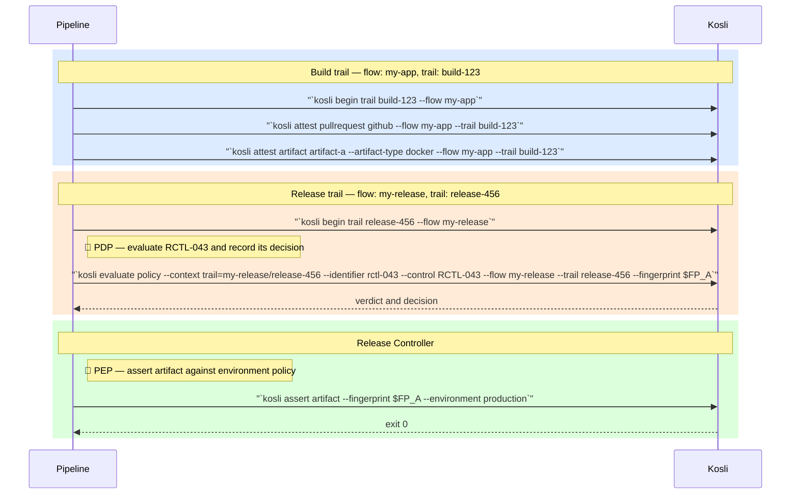

<Info>
**This feature is in beta.** Controls, decisions, the controls CLI commands (`kosli create control` and related), server-side evaluation (`kosli publish rego-policy` and `kosli evaluate policy`), and the `for_control` policy requirement are all available in Kosli but in beta — the UI, CLI flags, and policy YAML schema may still change. It is rolled out per organization, so reach out to the Kosli team to enable it for yours, or with any questions and comments.
</Info>

Controls in Kosli represent the named, identifiable governance requirements that your organization enforces across software delivery — things like "source code review", "no hard-coded credentials", or "vulnerability scan passed". They are the things auditors ask about, the things compliance teams track, and the things governance platform engineers build automation around.

Without controls as first-class entities, Kosli can tell you _that_ an attestation was made, but not _which governance requirement it satisfies_. Controls close that gap: they connect the evidence you collect in pipelines to the specific requirements that auditors, control owners, and regulators care about.

This tutorial covers how to:

- Define a control library in Kosli that mirrors your existing controls catalog
- Record decisions against controls by evaluating published policies from your pipelines
- Reference controls in environment policies
- Review the decisions, coverage, and version history of each control

## Prerequisites

- [Install Kosli CLI](/getting_started/install).
- [Get a Kosli API token](/administration/authentication/service_accounts).
- Have at least one [Flow](/getting_started/flows) and [Trail](/getting_started/trails) already created.

## Setup

```bash
export KOSLI_ORG=<your-org>
export KOSLI_API_TOKEN=<your-api-token>
```

## Understanding controls

Before creating controls, it helps to understand how they fit into the Kosli data model.

**Raw fact attestations** are the evidence you collect in pipelines — test results, vulnerability scans, pull request approvals. These are facts about what happened.

**Decisions** are the recorded outcomes of a Policy Decision Point (PDP) — the step in your process where a judgment is reached about a specific control: "control `RCTL-043` is satisfied for this artifact." In Kosli, the PDP is a server-side evaluation: Kosli evaluates a published Rego policy against the trails you name and records the outcome as a decision against the control. A decision is recorded at the point where the judgment is made — typically during a release or promotion step.

A decision must be **complete**: one decision closes a control, and there is no partial decision. When a control depends on several checks — for example unit, integration, and system tests — the policy that records the control's decision has to cover all of them.

<Note>
  Multi-level evaluations are not supported yet: a policy cannot read the outcome of other evaluations or decisions, so several evaluations cannot be combined into one control's decision. Until then, write one policy per control that checks everything the control requires.
</Note>

**Controls** are the named governance requirements that decisions are recorded against. They have a stable identity (the control identifier), a human-readable name, and an optional description and links pointing back to your GRC system or policy document.

This separation matters: raw facts exist independently of controls. A JUnit test report is a fact. Whether that test report satisfies a "test coverage" control is a decision. The decision references the fact; the fact doesn't need to know about the control.

A Policy Enforcement Point (PEP) is where that decision is acted upon. `kosli assert artifact --environment` is the PEP — it checks that an artifact satisfies all requirements in the environment's policy, including any listed controls, and exits non-zero if it doesn't. Place it at the point in your pipeline where you want to gate progress on control compliance.

<Info>
  Kosli holds a mirror to your existing control definitions — it does not replace your GRC system or ServiceNow instance. The control catalog in Kosli is a lightweight copy that enables querying and reporting.
</Info>

## Creating a control

Navigate to **Controls** in the [Kosli app](https://app.kosli.com) sidebar and select **New control**. A control has the following fields:

| Field | Description |
|-------|-------------|
| **Identifier** | **Required.** The control identifier (e.g. `RCTL-043`, `peer-review`, `vuln-scan-production`). Unique within your organization and **immutable once created** — to use a different identifier, create a new control. |
| **Name** | **Required.** A human-readable label for the control (e.g. `Source code review`). You can rename a control while keeping the same identifier. |
| **Description** | Optional. What the control does, in human-readable terms. |
| **Links** | Optional. One or more named URLs pointing back to the authoritative definition in your GRC system, ServiceNow, or policy document. |

Only org admins can create or edit controls. **Tags** are added separately — from a control's detail page after it exists, or from the CLI with `kosli tag control CONTROL-IDENTIFIER --set key=value`. They're not part of the create form and don't create a new version.

Controls can also be managed from the command line, or programmatically through the controls API (`POST /api/v2/controls/{org}`). Create a control with `kosli create control` — `--name` is required and `--description` is optional:

```bash
kosli create control RCTL-043 \
    --name "Source code review" \
    --description "All changes are reviewed by a second developer before release."
```

Set or change a control's name, description, or links with `kosli update control`. Each update creates a new version:

```bash
kosli update control RCTL-043 \
    --description "All commits are reviewed by a second developer before release."
```

<Tip>
  Control identifiers are the stable identity that decisions and environment policies reference. Choose identifiers that match how your organization already refers to controls — for example, the identifiers in your ServiceNow or GRC system. If you use `RCTL-043` today, use exactly that.
</Tip>

### List your controls

Navigate to **Controls** in the [Kosli app](https://app.kosli.com) sidebar to browse your full controls catalog. Search by name or identifier, and filter by tag to narrow the list. Each control shows its identifier, description, tags, name, and current version.

Control definitions are versioned: each time you update a control's name, description, or links, a new version is created. This matters for audits — decisions recorded against a control always reference the exact version of the definition that was current when the decision was made, so the audit trail is precise even as controls evolve over time. A control's full version history is available on its **Versions** tab.

<Frame>
  
</Frame>

You can also list controls from the CLI with `kosli list controls`, fetch a single control with `kosli get control CONTROL-IDENTIFIER`, or use the controls API (`GET /api/v2/controls/{org}`).

### Archiving a control

When a control is retired, archive it rather than deleting it. Archiving moves the control out of the main catalog into its **Archived** view but preserves its full history — past decisions and every version of the definition remain intact for audit — and an archived control can be unarchived later if it comes back into use.

Archive or unarchive a control from its detail page (org admins only), from the CLI with `kosli archive control CONTROL-IDENTIFIER` and `kosli unarchive control CONTROL-IDENTIFIER`, or through the controls API (`POST /api/v2/controls/{org}/{identifier}/archive` and `.../unarchive`). Both actions appear as events in the control's **Versions** tab, alongside Created and Edited events, so the full lifecycle is auditable.

## Recording a decision against a control

A decision is recorded by evaluating a published Rego policy and naming the control it answers. An evaluation records a decision only from a published policy: publishing is limited to org admins and Kosli validates the policy, so the team being assessed cannot supply the policy that judges it.

First, publish the policy. Each publish stores a new version, and an evaluation runs the current one:

```bash
kosli publish rego-policy rctl-043 \
    --path rctl-043.rego \
    --input-schema trail \
    --name "Source code review"
```

The policy follows the [Rego policy contract](/policy-reference/rego_policy), and `--input-schema trail` gives it the same `input` that `kosli evaluate trail` does.

Then evaluate it and record the outcome as a decision. Use `--fingerprint` to identify the artifact the decision applies to — this is what allows `kosli assert artifact --environment` to later check that all required controls have passing decisions for that artifact specifically.

```bash
kosli evaluate policy \
    --context trail=my-release-flow/my-release-trail \
    --identifier rctl-043 \
    --control RCTL-043 \
    --flow my-release-flow \
    --trail my-release-trail \
    --fingerprint "$ARTIFACT_FINGERPRINT" \
    --name source-code-review-decision
```

| Flag | Description |
|------|-------------|
| `--context` | **Required.** A trail to evaluate, as `trail=<flow>/<trail>`. Repeat it to evaluate several trails at the same instant. |
| `--identifier` | **Required to record a decision.** The published policy to evaluate. Its current version runs, and the decision cites that version. |
| `--control` | The control identifier the decision is recorded against. Without it, the evaluation records nothing. |
| `--flow`, `--trail` | The flow and trail the decision is recorded in. Required with `--control`; can be set as `KOSLI_FLOW` and `KOSLI_TRAIL`. |
| `--fingerprint` | The SHA256 fingerprint of the artifact the decision applies to. Omit it to record the decision against the trail itself. |
| `--name` | The attestation name the decision is recorded under. Defaults to `<control>-decision`. |
| `--params` | Values the policy reads as `data.params`, as inline JSON or `@file.json`. They must match the params schema of the policy's current version. |

Kosli evaluates the policy where the trails are stored and records the decision in the same request, so the outcome never passes through your pipeline. The decision carries its evidence: the policy version that ran, the params, the result, and the policy files as an attachment. You can record more than one decision for the same control; the most recent one is used when evaluating compliance.

An evaluation without `--control` records nothing. Use it to try a policy out — `--path` sends local policy files instead of a published policy, but cannot be used with `--control`.

## Asserting artifact compliance

`kosli assert artifact --environment` is the Policy Enforcement Point (PEP). It checks that an artifact satisfies all requirements in the environment's attached policy — including any controls required via `for_control` rules — and exits non-zero if it doesn't. Use it as a pipeline gate before promoting an artifact to an environment.

```bash
kosli assert artifact \
    --fingerprint "$ARTIFACT_FINGERPRINT" \
    --environment production
```

| Flag | Description |
|------|-------------|
| `--fingerprint` | The SHA256 fingerprint of the artifact to assert. |
| `--artifact-type` | The artifact type (e.g. `docker`, `file`). Provide this with the artifact name/path as the command argument instead of `--fingerprint` to have Kosli calculate the fingerprint. |
| `--environment` | **Required.** The Kosli environment whose attached policy the artifact is asserted against. |

If the artifact satisfies all policy requirements — including passing decisions for every listed control — the command exits 0. If not, the command exits non-zero and prints which requirements were not met, failing the pipeline step.

<Tip>
  `kosli evaluate policy --control` is the PDP: it records a judgment about a control. `kosli assert artifact --environment` is the PEP: it enforces that judgment as part of the environment policy. Keep them in separate pipeline steps — the PDP step is where evidence is evaluated and the outcome is recorded; the PEP step is where the pipeline gates on that recorded outcome.
</Tip>

## End-to-end pipeline flow

The sequence below shows a single artifact moving through a build trail and a release trail, with the compliance decision made at release time and enforced by the release controller checking the environment policy.



## Referencing controls in environment policies

Environment policies define the requirements an artifact must satisfy before it can run in a given environment. You can require that specific named controls have a passing decision recorded, making individual controls explicit policy gates.

```yaml prod-policy.yaml
_schema: https://docs.kosli.com/schemas/policy/v1
artifacts:
  provenance:
    required: true
  attestations:
    - type: decision
      for_control: RCTL-043
    - type: decision
      for_control: RCTL-1866
```

Each `attestations` rule with `type: decision` and a `for_control` identifier requires a compliant decision recorded for that control. The control must already exist in your organization — unlike recording a decision, a policy that references an unknown control identifier is rejected. With this policy in place, an artifact deployed to this environment will be marked **non-compliant** if a passing decision has not been recorded for that artifact for each listed control. The artifact can still be deployed — Kosli records compliance state but does not block deployments by default. To gate deployments on compliance, use [`kosli assert`](/getting_started/enforce_policies) in your pipeline. This abstracts the policy from the specific tooling your pipelines use: instead of "has an attestation of type `snyk` with zero criticals", the policy expresses "control `RCTL-1866` has been satisfied" — and the decision attestation carries the evidence of how that judgment was reached.

For the complete policy syntax, including attestation requirements and exceptions, see the [Environment Policies](/getting_started/policies) page.

## Viewing a control

Navigate to **Controls** in the [Kosli app](https://app.kosli.com) and select a control to see its detail view. The header shows the identifier, current version, name, any links, description, and tags. Below it are three tabs: **Decisions**, **Coverage**, and **Versions**.

### Decisions

The Decisions tab is the default view. It lists every decision recorded against this control across all flows and trails, with the timestamp, the trail it was recorded on, the artifact fingerprint, and the outcome (compliant or non-compliant). Filter by outcome and flow, and sort by timestamp, to narrow the list.

<Frame>
  
</Frame>

Select a decision to open its detail, showing the trail it is recorded on, the trails it was evaluated against and when, the policy and version that judged it, the artifact it applies to, and the evaluated policy bundle (`policy.tar.gz`) attached as evidence.

<Frame>
  
</Frame>

### Coverage

The Coverage tab shows how widely this control is enforced across your environments. A control is **covered** in an environment when that environment has an active [policy](/getting_started/policies) whose latest version references this control through a `for_control` requirement — regardless of whether the policy is currently passing. Coverage measures _enforcement reach_, not compliance: an environment whose policy references the control but is currently failing still counts as covered, and the policy name is shown so you can investigate.

At the top, a progress bar summarizes coverage as a percentage and as `N of M environments`. Below it, each environment is listed with the policy that covers it and a **Covered** or **Not covered** badge. Filter the list by environment name, and use the **Status** filter to show all environments, only covered, or only not covered — handy for focusing on enforcement gaps.

<Frame>
  
</Frame>

<Info>
  **Archived environments are excluded** from the coverage list and from the totals — they are not counted in `N of M`. Only active policies contribute to coverage: if a policy is archived or detached from an environment, that environment is no longer covered by it.
</Info>

Coverage is also available through the controls API: `GET /api/v2/controls/{org}/{identifier}/coverage` returns the summary (`total`, `covered`, `coverage_percent`) and a paginated list of environments, with name search and filtering by coverage state (`?covered=true` / `?covered=false`).

### Versions

The Versions tab lists every version of the control definition — the name, description, and links as they were at each version, with who made the change and when. Because every decision references the control version that was current when it was recorded, this history lets auditors see exactly what the control required at the time of each decision.

## What you've accomplished

You have learned how to define controls in Kosli, record decisions against them by evaluating published policies with `kosli evaluate policy --control` as the PDP, require controls in environment policies with `for_control`, assert artifact compliance using `kosli assert artifact --environment` as the PEP, and review the decisions, coverage, and version history of each control.

Your controls catalog is now the bridge between the evidence Kosli collects and the requirements your auditors, control owners, and regulators care about. For each production change, you can now answer: "which of our controls have a compliant decision recorded, and which don't?"

From here you can:

- Learn more about [controls](/understand_kosli/controls)
- Learn more about [environment policies](/getting_started/policies)
- Learn more about [attestations](/getting_started/attestations)
